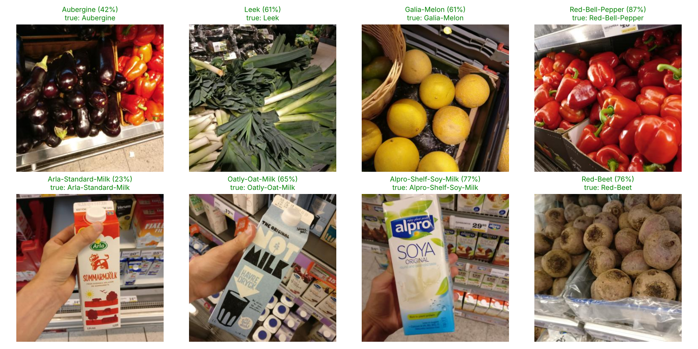

# 🛒 Smart Supermarket: Grocery Product Recognition and Table OCR

An HCCDA-AI project that applies all four Huawei Cloud HCCDA-AI labs to a real retail problem: recognizing grocery products from shelf photos and reading tables from images. It runs anywhere (laptop, Google Colab, Streamlit Cloud) while following the same steps as the Huawei labs.

**Live demo:** _add your Streamlit Cloud link here after deploying (see [Deploy](#4-deploy-a-public-demo-free))_

## Results

Tested on 2,485 photos the model never saw (the dataset's official test split):

| Metric | Score |
|---|---|
| Exact product (81 classes) | **75.6%** |
| Product type (43 classes) | **85.5%** |
| Correct answer in top 5 | **97.0%** |

| Category | Accuracy |
|---|---|
| Vegetables | 86.7% |
| Fruit | 73.1% |
| Packages | 70.9% |

**Where it struggles:** look-alike products (Satsumas vs Orange, vanilla vs blueberry yoghurt), and the 7 products with fewer than 20 training photos (65.3% vs 76.1% for the rest). More photos of those products is the clearest improvement, as the Lab 4 quiz suggests.



## How the Huawei lab steps map to this project

| Lab | Huawei Cloud step | In this project |
|---|---|---|
| Lab 1 | OBS parallel file system + `input` folder | `models/`, `samples/`, `docs/` folders |
| Lab 1 | Mount OBS at `/data/input`, `np.save(...)` | Notebook saves arrays to `outputs/` (or `/data/input` on ModelArts) |
| Lab 1 | NumPy arrays, indexing, `all`/`any`/`where`, `newaxis` | Notebook Part 2: analysis of all 5,421 images as a 4-D array |
| Lab 2 | ModelArts notebook (CPU 2 vCPUs 8 GB) | `notebooks/` runs in Jupyter, Colab, or ModelArts |
| Lab 2 | Threads + mutex, `re` module, magic methods | Notebook Part 1: threaded image loader, regex index parser, `Product` class |
| Lab 2 | MoXing copy to OBS | Notebook's last cell (runs only on ModelArts) |
| Lab 3 | Subscribe to OCR, get AK/SK + Project ID | Same, then set them as environment variables or Streamlit secrets |
| Lab 3 | ECS + security group port 8501 | The app runs on port **8501** (`.streamlit/config.toml`) |
| Lab 3 | `main.py` calls RecognizeGeneralTable | `src/ocr.py`, used by the app's **OCR General Table** tab |
| Lab 4 | Download data and code to the notebook | `train.py` downloads the dataset and trains the model |
| Lab 4 | Model Management → Create Model | `models/grocery_classifier.joblib` (+ `src/model.py`) |
| Lab 4 | Deploy → Real-Time Service | `streamlit run app.py` |
| Lab 4 | Upload a test image → Predict | The app's **Prediction** tab |

## Project structure

```
├── app.py                  # Web app (real-time service + OCR), port 8501
├── train.py                # Retrains the model from the dataset
├── src/
│   ├── model.py            # GroceryRecognizer: MobileNetV2 features + logistic regression
│   └── ocr.py              # Huawei OCR General Table helper
├── models/grocery_classifier.joblib   # Trained model (450 KB)
├── notebooks/Smart_Supermarket_HCCDA_AI_Project.ipynb  # Full analysis, Labs 1–4
├── samples/                # Test photos for the demo
├── docs/                   # Charts and the results table image
└── requirements.txt
```

## Run it

### 1. Run the app on your computer
```bash
git clone https://github.com/<your-username>/<repo-name>.git
cd <repo-name>
pip install -r requirements.txt
streamlit run app.py
```
Open **http://localhost:8501**. The first prediction downloads the MobileNetV2 weights (about 14 MB).

### 2. Run the notebook
Open `notebooks/Smart_Supermarket_HCCDA_AI_Project.ipynb` in Jupyter, or upload it to [Google Colab](https://colab.research.google.com) and choose **Runtime → Run all**. It downloads the dataset itself. A full run takes about 5 to 10 minutes on a CPU.

### 3. Retrain the model (optional)
```bash
python train.py
```

### 4. Deploy a public demo (free)
1. Push this repo to GitHub (public).
2. Go to [share.streamlit.io](https://share.streamlit.io), sign in with GitHub, click **Create app**.
3. Pick the repo, branch `main`, main file `app.py`, and click **Deploy**. The first build takes a few minutes because it installs PyTorch.
4. Copy the app's URL into the **Live demo** line at the top of this README.

### 5. Turn on the OCR tab (optional, uses your Huawei account)
1. OCR console, region **AP-Singapore** → **General Table → Subscribe**.
2. **My Credentials**: copy the AP-Singapore Project ID, create an access key.
3. Locally:
   ```bash
   export HUAWEICLOUD_SDK_AK="your AK"
   export HUAWEICLOUD_SDK_SK="your SK"
   export HUAWEICLOUD_PROJECT_ID="your project ID"
   ```
   On Streamlit Cloud: app **Settings → Secrets**, add the same three keys:
   ```toml
   HUAWEICLOUD_SDK_AK = "your AK"
   HUAWEICLOUD_SDK_SK = "your SK"
   HUAWEICLOUD_PROJECT_ID = "your project ID"
   ```
Never commit keys to the repo. `.gitignore` already excludes `secrets.toml`, `.env`, and `credentials.csv`.

## Dataset

[Grocery Store Dataset](https://github.com/marcusklasson/GroceryStoreDataset) (MIT license): 5,421 phone photos of 81 products taken inside supermarkets.

Klasson, M., Zhang, C., and Kjellström, H. *A Hierarchical Grocery Store Image Dataset with Visual and Semantic Labels.* IEEE Winter Conference on Applications of Computer Vision (WACV), 2019.
